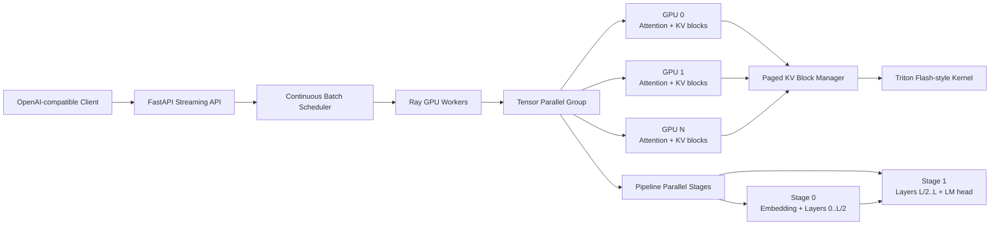

# DistributedLLM-Engine

DistributedLLM-Engine is a CUDA-first research and production foundation for training, quantizing, and serving decoder-only language models across multiple GPUs. It combines explicit device management, vLLM-style paged KV caching, tensor parallel layers, FSDP/LoRA training, Triton attention kernels, and an asynchronous token-streaming API.

> This repository is intentionally explicit about hardware assumptions. CPU-only environments can run configuration, import, and unit tests; CUDA kernels, NCCL collectives, bitsandbytes CUDA paths, and multi-GPU benchmarks require the stated NVIDIA stack.

## Architecture



### Parallelism model

For tensor parallel degree `T`, a column-parallel projection partitions `W ∈ R^(d_in × d_out)` as `W = [W_0 | ... | W_(T-1)]`; each rank computes `Y_r = X W_r`. A row-parallel projection partitions the input dimension and performs an all-reduce: `Y = Σ_r X_r W_r`. Pipeline parallelism assigns contiguous layer ranges to stages and transfers activations between neighboring ranks. Data parallel replicas are layered above these groups through FSDP.

## Mathematical specifications

### PagedAttention

The logical KV sequence is split into fixed-size blocks of `B` tokens. A block table `P ∈ N^(batch × blocks)` maps each logical block to a physical cache block. For query `q` and head keys/values `K_b, V_b`:

`a_i = exp(q · K_i / √d) / Σ_j exp(q · K_j / √d)`

`Attention(q) = Σ_i a_i V_i`, where token `i` is read from physical block `P[⌊i/B⌋]` at offset `i mod B`. The allocator reuses freed blocks and never requires a contiguous sequence-sized KV allocation.

### Rotary Position Embeddings

For pair `(x_2j, x_(2j+1))` and angle `θ_j = pos / 10000^(2j/d)`, RoPE applies:

`x'_2j = x_2j cos(θ_j) - x_(2j+1) sin(θ_j)`

`x'_(2j+1) = x_2j sin(θ_j) + x_(2j+1) cos(θ_j)`

The same rotation is applied to queries and keys, making relative position information emerge naturally in their dot product.

### Quantization

For symmetric INT8, `s = max(|w|) / 127`, `q = clamp(round(w / s), -127, 127)`, and `w_hat = s q`. For blockwise INT4, a block scale `s_b = max(|w_b|) / 7` and packed nibble `q_b = clamp(round(w_b / s_b), -8, 7)` reduce weight storage to four bits per value. NF4 instead maps normalized values to a learned normal-distribution codebook, minimizing quantization error for Gaussian weight distributions.

## Hardware requirements

| Model | FP16 weights | FP16 weights + KV (long context) | Recommended GPUs |
|---|---:|---:|---|
| 7B | ~14 GB | 20–28 GB | 1× 24 GB or 2× 16 GB |
| 13B | ~26 GB | 36–48 GB | 2× 24 GB or 4× 16 GB |
| 70B | ~140 GB | 180+ GB | 8× 80 GB |

INT4 weights reduce the weight footprint by approximately 4× before runtime activations and KV cache. The engine expects NVIDIA drivers with CUDA 12.1+, NVIDIA Container Toolkit, NCCL, and compute capability 8.0+ for the fastest kernels.

## Quick start

```bash
cp .env.example .env
docker compose build
docker compose run --rm engine python -m tests.smoke
docker compose up
```

For a real distributed launch:

```bash
torchrun --standalone --nproc-per-node=4 -m engine.training.fsdp_trainer \
  --model meta-llama/Llama-3.1-8B \
  --dataset ./data/train.jsonl \
  --output ./checkpoints/llama-adapter
```

## Repository map

```text
engine/
  memory/paged_attention.py       block allocator and KV cache lifecycle
  models/llama_tp.py              tensor-parallel linear and transformer primitives
  quantization/bitsandbytes_quant.py  NF4/INT8 loading and dequantization
  training/fsdp_trainer.py        FSDP + LoRA/QLoRA training entry point
  serving/api_server.py           async continuous-batching token API
docker-compose.yml                CUDA/NCCL development topology
```

## Operational guardrails

- Never enable `trust_remote_code` for an unreviewed model in production.
- Pin model revisions and dataset hashes; record CUDA, driver, PyTorch, and kernel versions with checkpoints.
- Use NCCL timeouts and rank-aware logging so failed collectives do not hang indefinitely.
- Apply authentication, per-tenant quotas, prompt limits, and output moderation at the API boundary.
- Benchmark every kernel against a numerically stable PyTorch reference before enabling it by default.
